# Birdcage UI 골든 화면

Birdcage CEP 패널의 주요 상태를 실제 `Controller`와 결정적인 가짜 Helper 응답으로 렌더링한 회귀 기준입니다. 현재 기준은 픽셀 골든 24개와 DOM 구조 골든 22개입니다.

## 검증 기준

- `dom/`: 운영체제와 브라우저에 관계없이 비교하는 구조 기준입니다. 보이는 문구, 상태, 접근성 속성과 핵심 DOM을 확인합니다.
- `chrome-154-darwin27-arm64/`: Chrome 154, macOS 27, arm64에서만 픽셀 단위로 비교하는 화면 기준입니다.
- 시간·경로·도구 버전·썸네일·미디어 응답은 고정되어 있으며 마스크는 사용하지 않습니다.
- 이 디렉터리는 검증기 보호 경로입니다. 기존 골든을 바꾸려면 `verifier.change` 사람 승인을 먼저 기록하고, 화면 의미가 달라지는 픽셀 변경은 사람 확인 증적도 남깁니다.

```bash
cd panel/cep
npm run -s test:ui

# 승인된 기준 변경에서만 실행
npm run -s test:ui -- --update-snapshots
```

새 상태를 추가할 때는 `test/ui/scenarios.ts`에 실제 Controller 흐름을 만들고, DOM 골든과 고정 환경의 픽셀 골든을 함께 추가합니다. 넓은 화면처럼 DOM이 같고 뷰포트 배치만 다른 경우에는 픽셀 골든만 추가할 수 있습니다.

## 시작·도구 상태

| 화면 | 시나리오 | 구조 기준 |
|---|---|---|
| 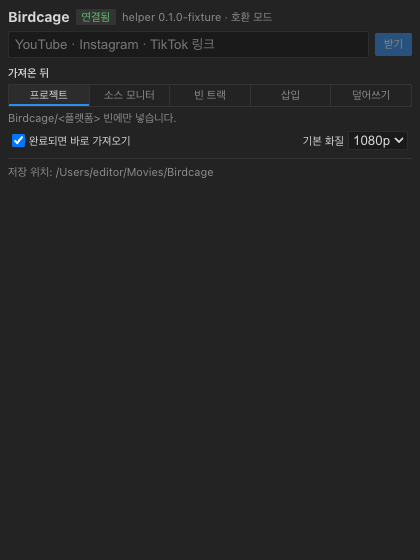 | `empty` — 연결 완료, 링크 입력 대기 | [DOM](dom/empty-dom.json) |
| 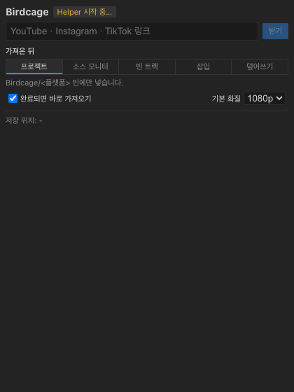 | `starting` — Helper 시작 중 | [DOM](dom/starting-dom.json) |
| 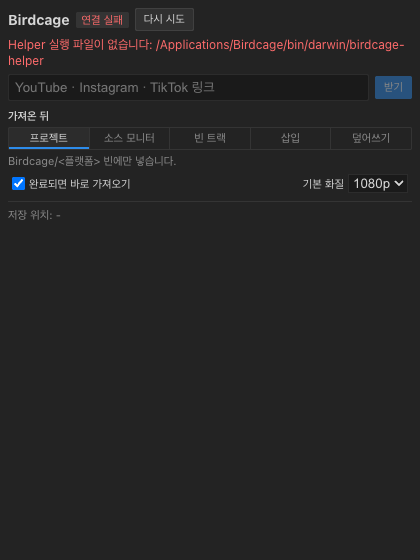 | `connection-failed` — Helper 실행 실패와 다시 시도 | [DOM](dom/connection-failed-dom.json) |
| 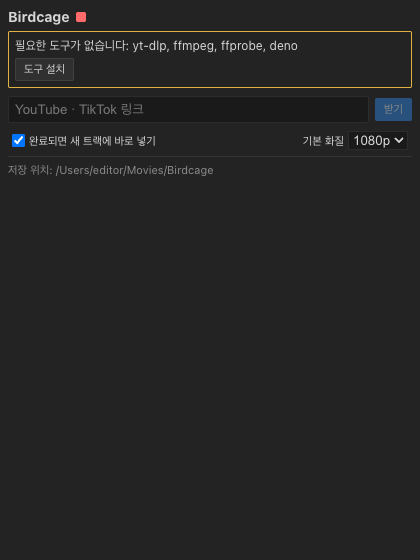 | `missing-tools` — 필수 도구 없음과 설치 안내 | [DOM](dom/missing-tools-dom.json) |
| 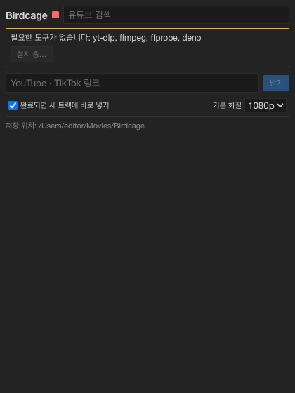 | `tools-installing` — 필수 도구 설치 중 | [DOM](dom/tools-installing-dom.json) |

## 링크 확인·미리보기·다운로드

| 화면 | 시나리오 | 구조 기준 |
|---|---|---|
| 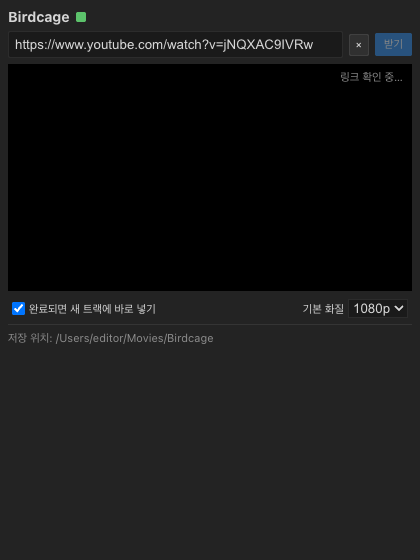 | `probing` — 붙여넣은 링크 확인 중 | [DOM](dom/probing-dom.json) |
| 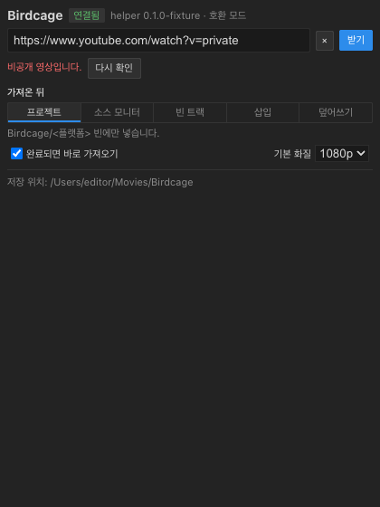 | `probe-failed` — 분류된 조회 실패와 다시 확인 | [DOM](dom/probe-failed-dom.json) |
| 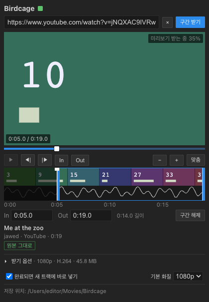 | `probed` — 조회 완료, 스토리보드·파형 미리보기 준비 중 | [DOM](dom/probed-dom.json) |
| 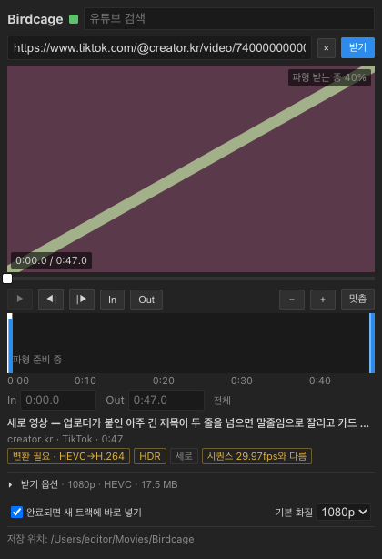 | `probed-warnings` — 세로·HDR·변환 필요·fps 차이 경고 | [DOM](dom/probed-warnings-dom.json) |
| 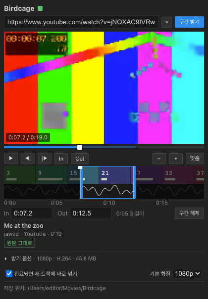 | `preview-ready` — 재생 미리보기와 In/Out 선택 준비 | [DOM](dom/preview-ready-dom.json) |
|  | `preview-downloading` — 현재 요청의 단계·속도·남은 시간 | [DOM](dom/preview-downloading-dom.json) |
| 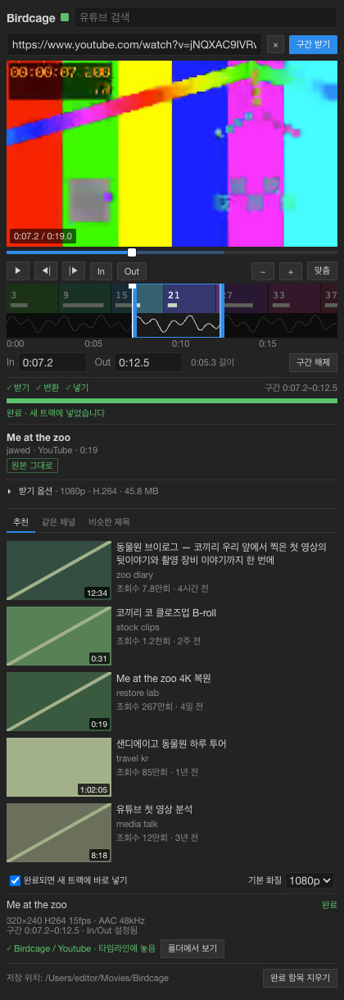 | `preview-placed` — 다운로드·변환·Premiere 배치 완료 | [DOM](dom/preview-placed-dom.json) |
| 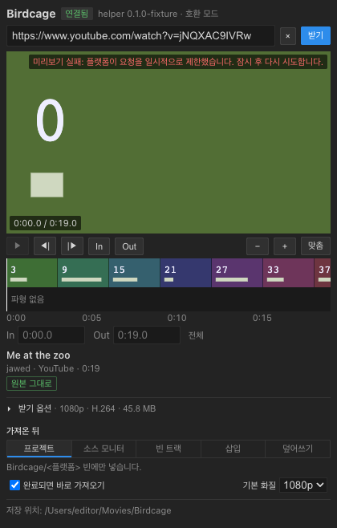 | `preview-failed` — 미리보기 실패 후 기존 정보 유지 | [DOM](dom/preview-failed-dom.json) |
| 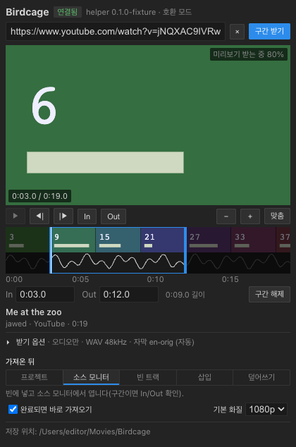 | `audio-only` — 오디오 전용·자동 자막·구간 옵션 | [DOM](dom/audio-only-dom.json) |

## 탐색 목록

| 화면 | 시나리오 | 구조 기준 |
|---|---|---|
| 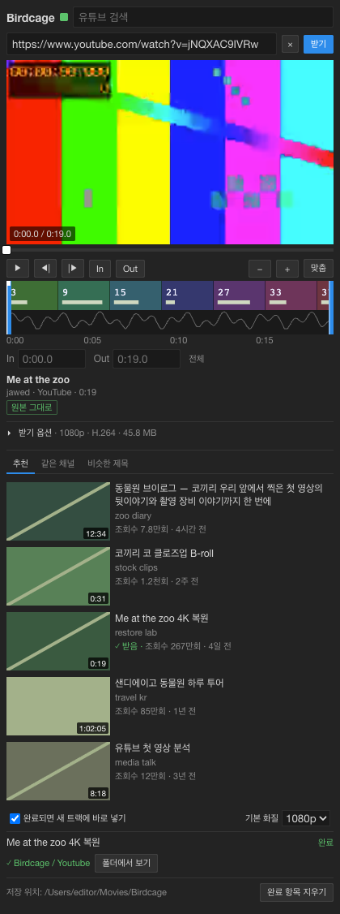 | `related-loaded` — 좁은 패널의 추천 목록과 받은 영상 표시 | [DOM](dom/related-loaded-dom.json) |
| 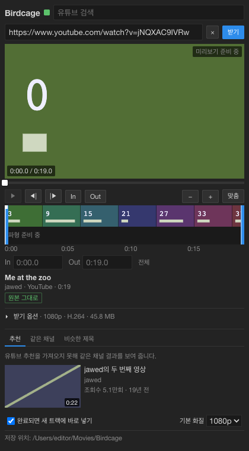 | `related-fallback` — 추천 실패 후 같은 채널 결과로 대체 | [DOM](dom/related-fallback-dom.json) |
| 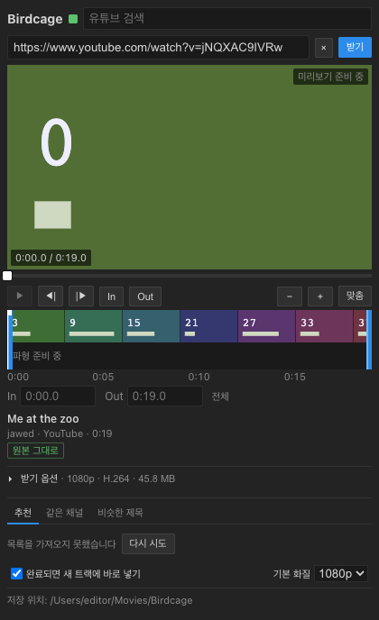 | `related-failed` — 탐색 목록 실패와 다시 시도 | [DOM](dom/related-failed-dom.json) |
| 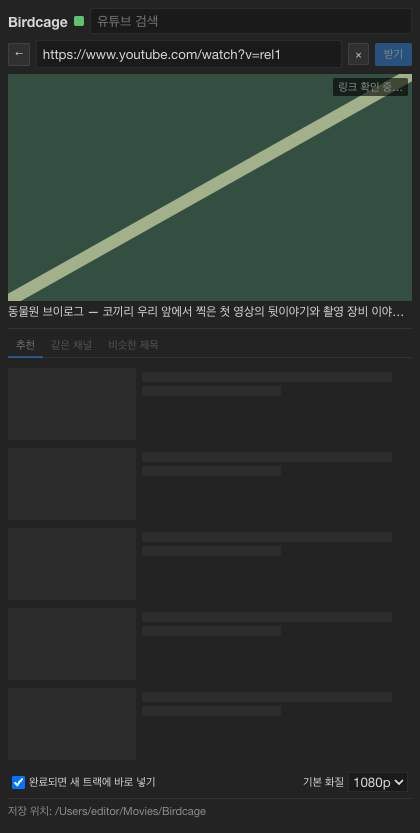 | `related-opening` — 추천 영상 조회 중과 이전 영상 복원 | [DOM](dom/related-opening-dom.json) |
| 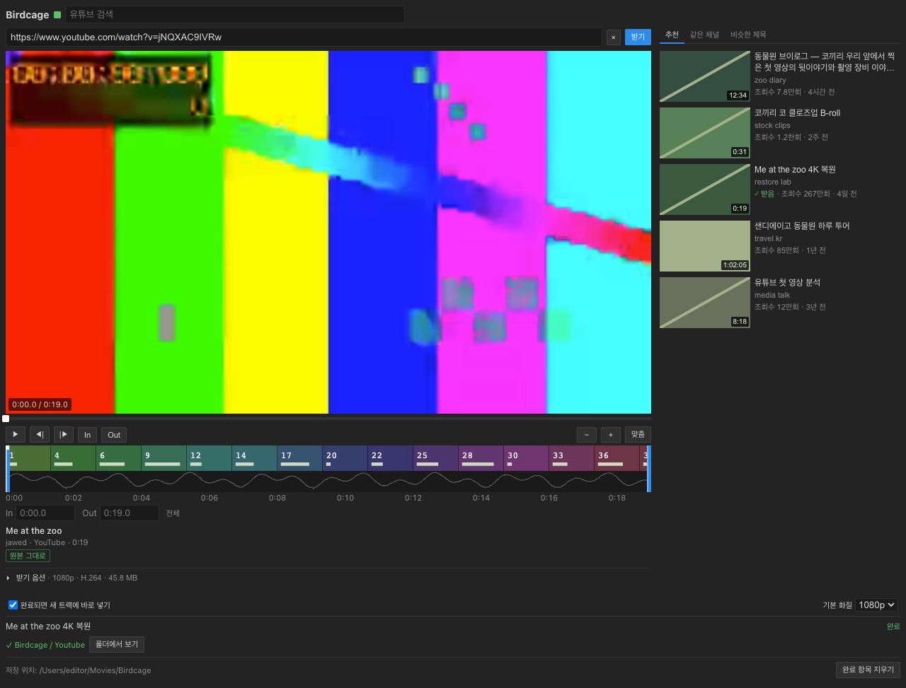 | `related-wide` — 넓은 패널의 오른쪽 탐색 사이드바 | DOM은 `related-loaded`와 동일 |

## 유튜브 검색

| 화면 | 시나리오 | 구조 기준 |
|---|---|---|
| 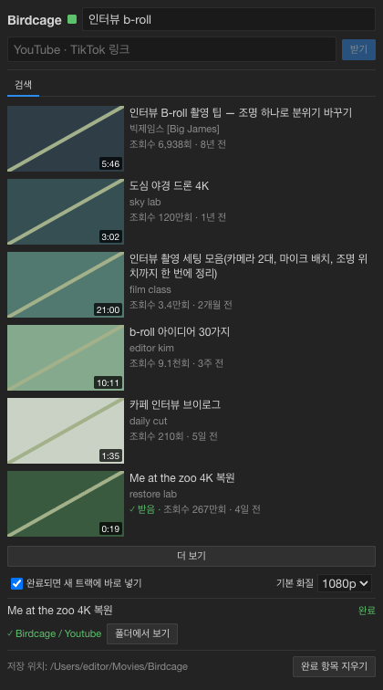 | `search-results` — 검색 결과, 받은 영상 표시와 더 보기 | [DOM](dom/search-results-dom.json) |
| 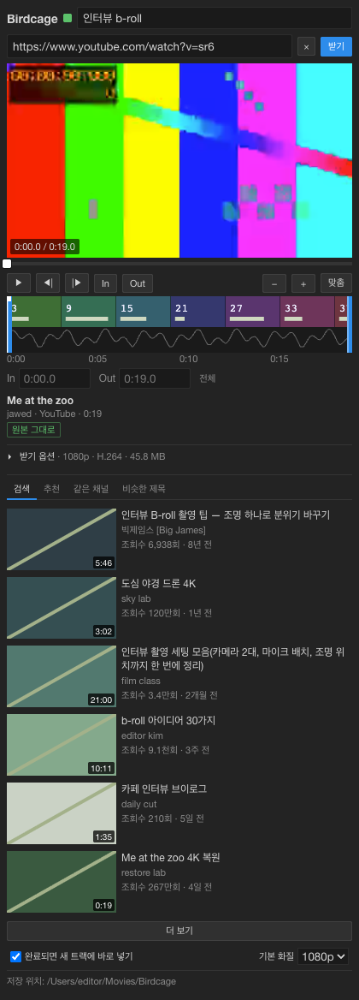 | `search-preview` — 검색 결과에서 연 영상과 유지된 검색 목록 | [DOM](dom/search-preview-dom.json) |
| 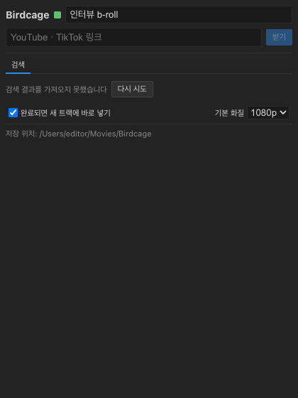 | `search-failed` — 검색 실패와 다시 시도 | [DOM](dom/search-failed-dom.json) |
| 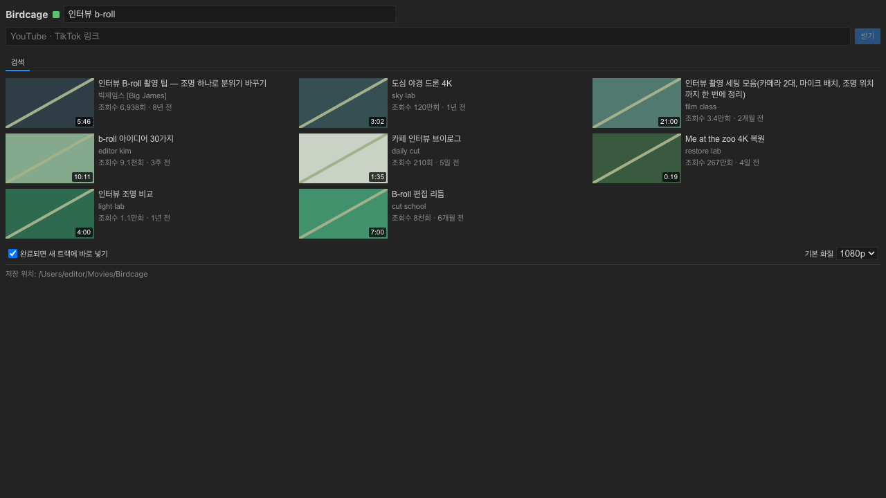 | `search-wide` — 넓은 패널의 다열 검색 결과 | DOM은 `search-results`와 동일 |

## 다운로드 목록

| 화면 | 시나리오 | 구조 기준 |
|---|---|---|
| 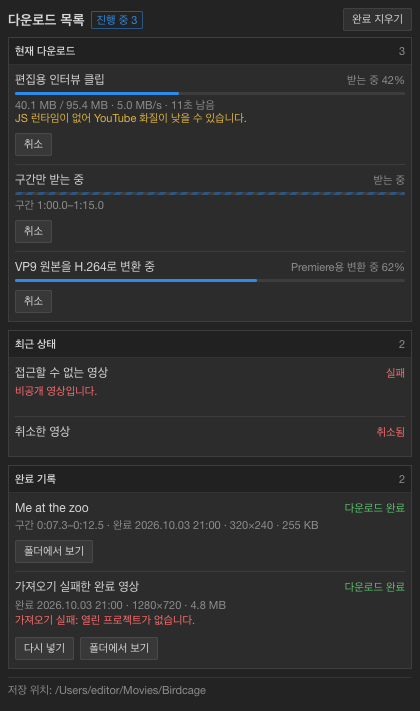 | `jobs` — 다운로드·구간 처리·변환·완료·실패·취소 기록 | [DOM](dom/jobs-dom.json) |
